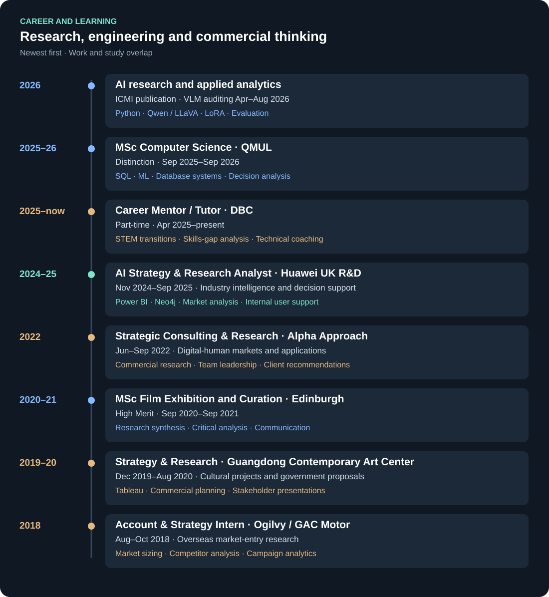

I build data tools, evaluate AI models and translate research into practical decisions. My work connects **technical evidence, commercial analysis and delivery**.

**MSc Computer Science, Queen Mary University of London — Distinction**  
Previously **AI Strategy & Research Analyst, Huawei UK R&D** · London

**[Explore my visual portfolio →](https://chenymwork-eng.github.io/)**

[Projects](#selected-projects) · [Timeline](#career-and-learning-timeline) · [Skills](#skills-in-context) · [Publication](#publication)  
[LinkedIn](https://www.linkedin.com/in/yumeng-chen-5a7578214/) · [Kaggle](https://www.kaggle.com/yumengchen8097) · [Detailed portfolio](projects/portfolio-details.md)

## Selected projects

### 01 / Source Intelligence Platform
**Ongoing · Team project · System development and support**

Developing and maintaining the system, with responsibility for technical support and technical consulting. A live demonstration is available below.

**System development · Maintenance · Technical support · Technical consulting**  
[Open the live demo →](https://source-intelligence-demo-nc2026.bronzecocoa16.chatgpt.site)

### 02 / Cross-cultural AI evaluation and model auditing
**Apr–Aug 2026 · MSc research · Related paper published at ACM ICMI 2026**

Built multimodal evaluation workflows and controlled prompt comparisons across Qwen2.5-VL and LLaVA-NeXT; trained and evaluated Qwen adapters using LoRA / QLoRA. Analysed how cultural framing and annotation standards affect model behaviour, separating changes in predictions from improvements in accuracy.

**Python · VLMs · Prompt auditing · LoRA / QLoRA · Error analysis**  
[Read the published paper →](https://doi.org/10.1145/3776574.3832464)

### 03 / Beyond averages
**2026 · Completed · Socio-economic segmentation**

Analysed **48,842 records**, comparing gender-stratified K-Means and GMM solutions through model-selection diagnostics and interpretable profiles. Explored differences that overall averages hide; potential business applications remain hypotheses for validation.

**Python · Data preparation · Clustering · PCA · Statistical interpretation**  
[Explore the findings and original report visuals →](https://github.com/chenymwork-eng/adult-income-gender-clustering)

### 04 / Amytis — Make it easier to resume
**Completed team prototype · User research → product design**

The team's **12 survey responses and 5 interviews** informed a **Now / Next / Context** workspace for researchers. I contributed to interviews, analysis, personas, interaction design, prototyping and evaluation. Resume, Focus Mode and activity trails are design responses; reduced cognitive load is an intended benefit, and AI summaries remain conceptual.

**User research · Requirements · Prototyping · Usability evaluation**  
[See how research shaped the prototype →](https://github.com/chenymwork-eng/ISD-Reseach-App-for-neurodivergent)

<strong>More analytics and engineering projects</strong>

- **Interactive COVID-19 dashboard — 2026:** API and JSON data preparation, refresh workflows, time-series charts and interactive filters. Python, pandas, matplotlib, ipywidgets.
- **Transport database and SQL analytics — 2025:** 3NF relational design, integrity constraints and analytical queries for transport usage and operational reporting. [Overview →](projects/portfolio-details.md#03--london-underground-database-system)
- **Risk and decision analysis — completed:** Bayesian modelling, counterfactual reasoning and expected utility to connect uncertainty and model errors with decisions. [Case study →](projects/risk-and-decision-analysis.md)
- **Reproducible LLM fine-tuning — ongoing:** instruction-data preparation, Transformers, PEFT and base-versus-adapted evaluation. [Overview →](projects/portfolio-details.md#05--reproducible-llm-fine-tuning)
- **Sustainable banking prototype:** transaction analysis translated into an illustrative product concept. [Case study →](https://www.kaggle.com/writeups/yumengchen8097/sustainable-banking-from-transaction-data-to-prod)

## Career and learning timeline

<strong>Timeline as text</strong>

| Period | Experience | Focus |
| :--- | :--- | :--- |
| Apr–Aug 2026 | Cross-cultural AI evaluation and model auditing | VLM evaluation, model adaptation and error analysis |
| Sep 2025–Sep 2026 | MSc Computer Science, QMUL — Distinction | Data analytics, databases and decision science |
| Apr 2025–present | DBC, Career Mentor / Tutor — part-time | STEM career and academic strategies, technical coaching |
| Nov 2024–Sep 2025 | Huawei UK R&D, AI Strategy & Research Analyst | BI, knowledge graphs, AI markets and opportunity assessment |
| Jun–Sep 2022 | Alpha Approach, Strategic Consulting & Research Intern | Digital-human research, commercial analysis and team delivery |
| Sep 2020–Sep 2021 | MSc Film Exhibition and Curation, Edinburgh — High Merit | Research, synthesis and critical analysis |
| Dec 2019–Aug 2020 | Guangdong Contemporary Art Center, Art Consulting & Research Associate | Cultural-market analysis and government project proposals |
| Aug–Oct 2018 | Ogilvy / GAC Motor, Account & Strategy Intern | Overseas market-entry research and campaign analysis |

Periods overlap; ongoing projects are shown separately rather than assigned an unconfirmed start date.

## Skills in context

| Capability | Tools and methods | Where I apply it |
| :--- | :--- | :--- |
| **Data analytics and BI** | Python, SQL, Power BI, Tableau, Excel; data integration, dashboards, statistical analysis | Huawei intelligence systems; segmentation; transport SQL; interactive dashboard |
| **AI development and evaluation** | Qwen, LLaVA, Transformers, PEFT, LoRA / QLoRA; prompt auditing, fairness and robustness analysis | Cross-cultural AI research; model adaptation and comparative evaluation |
| **Strategy and commercial analysis** | Market sizing, business planning, valuation, competitor and market-entry research | Huawei AI opportunities; Alpha Approach; cultural projects; Ogilvy |
| **Delivery and technical consulting** | Requirements gathering, system maintenance, user training, technical support, proposal presentations | Source Intelligence Platform; Huawei internal tools; government-facing proposals |
| **Product research and communication** | Interviews, personas, prototyping, evaluation, research synthesis, stakeholder reporting | Amytis; consulting projects; STEM career and academic coaching |

## Professional experience in practice

At **Huawei UK R&D**, I developed Power BI monitoring for **1,000+ companies**, structured a five-layer Neo4j knowledge graph and produced **5+ industry and investment insight reports**. I worked with R&D, HR, Legal and M&A on business requirements and decision support, and trained internal users on trackers, dashboards and the knowledge-graph resource system.

Commercial analysis covered European AI startups, investment and M&A opportunities, university partnerships and technology incubation. Internal data and implementation remain confidential.

At **DBC**, I deliver tailored career development, transition and academic strategies for STEM candidates and career changers, translating skills-gap analysis into actionable plans and managing engagements across positioning, mock interviews, academic writing support and technical skills training.

## Publication

**Chen, Y. & Zubiaga, A. (2026).** *TEAM_CHEN@CC-MMD 2026: Culture-Conditioned Prompting for Zero-Shot Misogynistic Meme Detection — Asymmetric Shifts and a Feminist Probe.* Proceedings of the 28th International Conference on Multimodal Interaction, pp. 1437–1442.  
[DOI: 10.1145/3776574.3832464](https://doi.org/10.1145/3776574.3832464)

**Interested in AI product delivery, analytics, technology consulting and responsible AI.**
